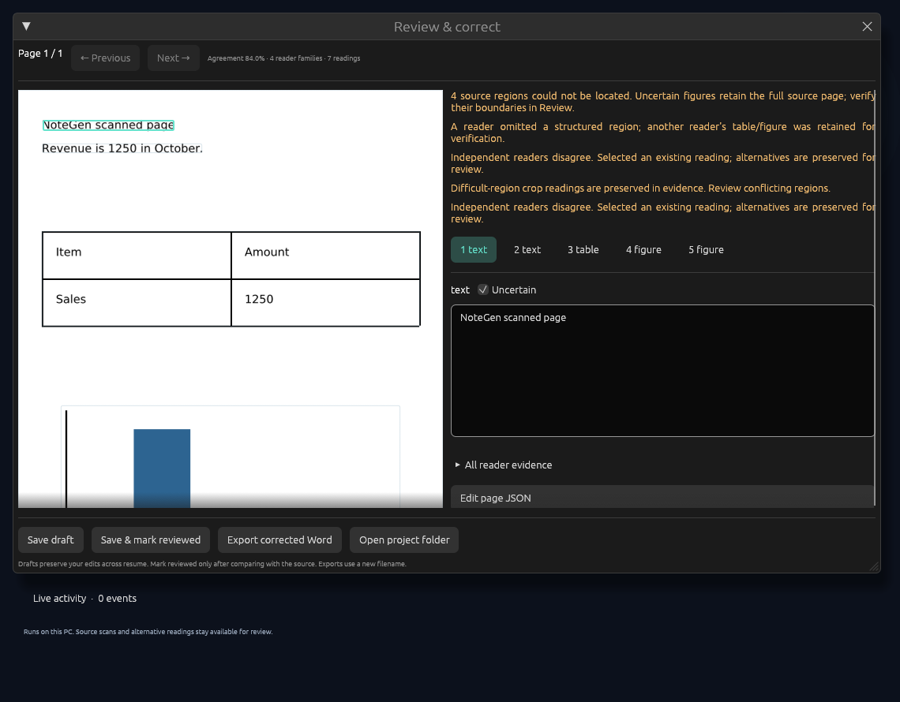

# NoteGen 0.3.0

**Scanned PDF & Handwritten Notes → Editable Word & Personal TrueType Fonts. Rust Desktop + Studio. Local AI. Adaptive NVIDIA Acceleration.**

NoteGen **0.3.0** transcribes print and handwriting with local readers, rebuilds editable Word
tables, preserves diagrams with observations and contextual interpretations, learns individual
writers' English handwriting patterns across pages, and exports personal installable TrueType (`.ttf`)
fonts. The desktop and pipeline are Rust; PDFium, Tesseract, and `llama.cpp` are native engines.

[Windows 0.3.0 Installer (`NoteGen-Setup-0.3.0.exe`)](https://github.com/InduwaraLasindu/NoteGen/releases/download/v0.3.0/NoteGen-Setup-0.3.0.exe)
· [Portable Executable (`NoteGen-0.3.0.exe`)](https://github.com/InduwaraLasindu/NoteGen/releases/download/v0.3.0/NoteGen-0.3.0.exe)
· [GitHub Releases (`v0.3.0`)](https://github.com/InduwaraLasindu/NoteGen/releases/tag/v0.3.0)
· [Portable Builds](https://github.com/InduwaraLasindu/NoteGen/actions/workflows/verify-and-build.yml)
· [Studio Guide](docs/STUDIO.md) · [Windows Setup](docs/WINDOWS.md) · [Verification](docs/TESTING.md) · [Installer Guide](docs/INSTALLER.md)

## Download & Install NoteGen 0.3.0 (Windows 10/11 x64)

1. **[Download NoteGen-Setup-0.3.0.exe](https://github.com/InduwaraLasindu/NoteGen/releases/download/v0.3.0/NoteGen-Setup-0.3.0.exe)** (or the standalone **[NoteGen-0.3.0.exe](https://github.com/InduwaraLasindu/NoteGen/releases/download/v0.3.0/NoteGen-0.3.0.exe)**) from the **[v0.3.0 Releases Tab](https://github.com/InduwaraLasindu/NoteGen/releases/tag/v0.3.0)**.
2. Run `NoteGen-Setup-0.3.0.exe` and follow the wizard. It installs per user for your Windows account (no administrator privileges required), adds Start menu shortcuts (`NoteGen`, `NoteGen Studio`, `Set up local AI`) and an optional desktop shortcut, and includes a clean uninstaller.
3. English printed OCR and Word (`.docx`) export work immediately out of the box. For local AI vision & handwriting readers, choose **NoteGen → Set up local AI** in the Start menu. Models, writer profiles, and document projects survive upgrades and uninstall.

| Release Asset (`v0.3.0`) | Description |
|---|---|
| **[`NoteGen-Setup-0.3.0.exe`](https://github.com/InduwaraLasindu/NoteGen/releases/download/v0.3.0/NoteGen-Setup-0.3.0.exe)** | Per-user Windows 10/11 x64 installer wizard (`Inno Setup` / `PE32+`) with Start menu shortcuts & uninstaller |
| **[`NoteGen-0.3.0.exe`](https://github.com/InduwaraLasindu/NoteGen/releases/download/v0.3.0/NoteGen-0.3.0.exe)** | Standalone Windows x64 portable executable (`PE32+`) — launch directly without installation |
| **[`NoteGen-Rust-Windows-x64.zip`](https://github.com/InduwaraLasindu/NoteGen/releases/download/v0.3.0/NoteGen-Rust-Windows-x64.zip)** | Portable Windows x64 bundle with `NoteGen.exe`, `notegen-cli.exe`, runtime scripts & licenses |
| **[`NoteGen-0.3.0-FontPack-AdaLovelace.zip`](https://github.com/InduwaraLasindu/NoteGen/releases/download/v0.3.0/NoteGen-0.3.0-FontPack-AdaLovelace.zip)** | Sample exported personal handwriting font pack (`Handwriting.ttf` + 50 SVG glyphs + coverage report) |
| **[`installer-manifest.json`](https://github.com/InduwaraLasindu/NoteGen/releases/download/v0.3.0/installer-manifest.json)** | SHA256 checksums, build provenance, and 7-chunk verification gate record |

## What's New in NoteGen 0.3.0

- **NoteGen Studio (`Context & Writers`)**: Unified studio modal for document subject/glossary guidance, interactive clarification questions, writer handwriting profiles, personal TrueType (`.ttf`) font pack export, 3rd-party AI model registration, and public Wikipedia/search grounding.
- **Interactive Clarification Inbox ("A little help with this page")**: Automatically identifies unrecognizable words, conflicting numbers/table cells, and diagram interpretations with zoomed source crops, one-click reader alternatives, and a contextual AI re-reading pass.
- **Writer Handwriting Profiles & Personal TrueType (`.ttf`) Font Pack Export**: Learn individual writers' English letter/word habits across pages (such as a distinctive lowercase `'r'`), attach confirmed glyph reference sheets to vision models, average up to 32 samples per character, and export an installable `.ttf` font (`0xB1B0AFBA` SFNT checksum) + SVG glyph pack.
- **3rd-Party AI Models & SHA256 Publisher Updates**: Register local GGUF + projector pairs or loopback OpenAI-compatible vision servers (`LM Studio`, `Ollama`, `vLLM`), and check/apply SHA256-verified publisher updates with one-click rollback across `LightOnOCR-3`, `GLM-OCR`, `Qwen3.5`, and `Qwen3.8`.
- **0.3.0 Codebase Audit & Regression Fixes**:
  - `NG-AUDIT-01` (`rust/src/writers.rs`): Fixed 4-edge perimeter dark-background inversion guard on tight glyph crops.
  - `NG-AUDIT-02` (`rust/src/consensus.rs`): Fixed trailing sentence punctuation normalization in `extract_numbers`.
  - `NG-AUDIT-03` (`rust/src/assistance.rs`): Added FNV-1a/SHA256 block digest guard so edited blocks can be re-clarified while resolved blocks are not re-prompted.
  - `NG-AUDIT-04` (`rust/src/fontpack.rs`): Verified clockwise outer contour winding and `0xB1B0AFBA` master TrueType checksum adjustment.

## Features

| Capability | Behavior |
|---|---|
| Adaptive hardware | CPU/SIMD, RAM and CUDA/Vulkan discovery; strongest fitting installed readers; memory re-admission before model load |
| Four presets | Fast printed OCR without loading/checksumming AI assets; Balanced with selective vision; Accuracy on every page; Maximum Accuracy with independent families and difficult-region crop retries |
| Print and handwriting | Tesseract baseline, LightOnOCR-3 / GLM-OCR specialists and Qwen vision; original source and all alternative readings retained |
| Ensemble decisions | Weighted medoid selects an observed transcript; duplicate models/crops do not count as independent agreement; numeric conflicts require review |
| Tables | Native ruled-grid recovery and HTML/Markdown/JSON tables; real Word cells, merges and repeated headers |
| Diagrams | Source crop, visible evidence and qualified contextual interpretation kept separately; interpretations require review |
| Scan preparation | Orientation detection, small-angle deskew, contrast normalization, blur warnings and image memory limits |
| Live activity | Stage/page progress, elapsed/estimated time, filterable activity, NG error codes and remedies; full JSONL/native runtime logs |
| Durable jobs | Queue, page ranges, pause, active-request cancellation, input/model/settings-bound checkpoints, restart recovery and protected output names |
| Review | Side-by-side source boxes, editable text/cells/diagram explanations, reader evidence, validated page JSON and persistent human corrections |
| Minimal native UI | Scanning-page motion graphic, orbiting accents, eased hover/preset transitions, progress sheen, completion check and animated drawers/windows; configurable in Advanced |
| Appearance controls | Light/dark, accent/background, scale, corners, speed, transition timing, orbit density, active/idle FPS, glow and reduced motion; live appearance preview while converting |
| Clarification | Source crops, exact word/number/cell corrections, contextual questions, skip/defer, and a protected local re-reading pass |
| Writer profiles | Named people, confirmed glyph/word memory, visual reference sheets, revision-aware caches, forget/delete, and profile ZIP import/export |
| Personal fonts | Real installable TTF, SVG glyphs, averaged confirmed letter samples, coverage report and preview; missing letters are reported |
| Third-party readers | Custom GGUF/projector pairs or loopback OpenAI-compatible vision services; explicit publisher update checks, SHA256-pinned activation and rollback |
| Optional public context | User-typed Wikipedia lookup, source-linked excerpts and explicit attachment; no scan/OCR/profile uploads |
| Offline CLI | Diagnostics, plans, model registration/updates, profiles/fonts, clarification, conversion, inspection and native export |

Windows UI rendering uses wgpu/Direct3D or Vulkan; AI uses CUDA/Vulkan through `llama.cpp`.
[Actual native motion preview](docs/images/notegen-motion.mp4). Open **Advanced → Appearance**
to customize it. Reduced motion freezes decorative graphics and transitions.

## Hardware and models

| VRAM | Illustrative automatic choice, when installed and enough memory is free |
|---|---|
| 4 GB | LightOnOCR-3 1B Q8 + Qwen3.5 2B Q4 |
| 8 GB | Small OCR specialist + Qwen3.5 4B Q5 |
| 16 GB | LightOnOCR-3 4B Q8 + Qwen3.5 9B Q5 |
| 32 GB | LightOnOCR-3 4B Q8 + Qwen3.8 27B Q4 |

Catalog checked **31 October 2026**: `LightOnOCR-3`, `GLM-OCR`, `Qwen3.5`, and `Qwen3.8`.
[Primary sources](docs/SOURCES.md) distinguish vendor models from community GGUF
conversions. Setup pins runtime `b11998` and immutable model revisions/checksums.

## Quality and verification

The NoteGen **0.3.0** codebase passes all **68 Rust tests** (`rust/tests/core.rs` + `rust/tests/engine.rs` + `rust/tests/v03.rs`), the **7-chunk Studio & Release verification gate** (`npx tsx --test src/utils/engine.test.ts`), and automated Windows installer validation (`scripts/Test-Installer.ps1`). See [exact evidence and limits](docs/TESTING.md).

## Build

~~~shell
rustup toolchain install 1.99.1 --profile minimal --component rustfmt --component clippy
cargo build --locked --release --features desktop --bins
cargo run --locked --bin notegen-cli -- doctor
cargo run --locked --features desktop --bin NoteGen
~~~

To build the Windows `0.3.0` installer locally with Inno Setup:

~~~powershell
.\scripts\Build-Windows.ps1 -OutDir dist\windows
.\scripts\Build-Installer.ps1 -Payload dist\windows\NoteGen -Version 0.3.0
.\scripts\Test-Installer.ps1 -Installer dist\installer\NoteGen-Setup-0.3.0.exe -Version 0.3.0
~~~

[Development](CONTRIBUTING.md). The [Python predecessor](legacy/python) is archived and
is not part of the Rust release. NoteGen is MIT-licensed; dependency/model terms apply.
