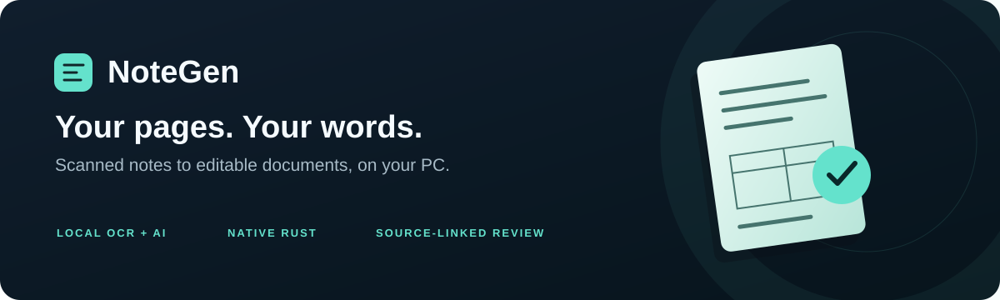

<p align="center"></p>

<p align="center">
  <a href="https://github.com/InduwaraLasindu/NoteGen/releases/latest">Download for Windows</a> ·
  <a href="docs/INSTALLER.md">Setup</a> ·
  <a href="docs/WORKBENCH.md">Workbench</a> ·
  <a href="docs/TESTING.md">Testing</a>
</p>

NoteGen turns scanned pages into editable documents using a native Rust desktop and local OCR/AI. Review uncertain text beside its source, repair tables, and keep diagrams with their evidence.


## Get started

1. Download and run the [Windows installer](https://github.com/InduwaraLasindu/NoteGen/releases/latest).
2. Import a PDF, PNG, JPEG, multipage TIFF or a folder of scans.
3. Convert, review flagged regions, and export a new document.

Printed English OCR works immediately. Select **Install local AI** for handwriting and additional readers. AI downloads may require several GB; the app selects compatible models and verifies their checksums. No Python or Rust installation is needed to use the installer.

The installer launches the OpenGL compatibility renderer. If the portable app fails to start on an older GPU, run `NoteGen.exe --renderer glow`.

## What it does

| Convert | Review | Organize and export |
|---|---|---|
| Printed and handwritten scans | Source regions and reader alternatives | Named projects, tags and local search |
| Editable tables and preserved figures | Named revisions, undo/redo and restore | Templates, references and recovery reports |
| CPU, CUDA or Vulkan readers | Numeric/table checks and disagreement overlays | Word, Markdown, HTML, LaTeX and Excel |
| Verified AI setup and offline bundles | Writer examples, quarantine and font proofs | Source links and uncertainty annotations |

Open **Projects & tools** or use the command palette (default **Ctrl+K**). Guides cover the [workbench](docs/WORKBENCH.md), [source review](docs/SOURCE_REVIEW.md), [page organization](docs/PROJECT_OPERATIONS.md), and [confirmed references](docs/CONFIRMED_REFERENCES.md). The [0.5.0 ledger](docs/FEATURES_0.5.0.md) records all 100 proposals and remaining work.

## Local by default

Recognition uses local files and loopback HTTP. Source scans are not uploaded. Update/model downloads use publisher services; optional public-topic lookup sends the query you type when enabled. Imported background references remain separate from transcription evidence.

Human review remains necessary for difficult handwriting, numbers and diagram interpretations. Reader agreement is not measured accuracy. Hardware budgets are estimates; broad handwriting accuracy and device performance require representative measurements. Windows installers are unsigned; releases include checksums and [build evidence](docs/BUILD_PROVENANCE.md).

## Build

```shell
rustup toolchain install 1.99.1 --profile minimal --component rustfmt --component clippy
cargo build --locked --release --features desktop --bins
cargo test --locked --all-features --all-targets -j 2
```

Tests require Tesseract and PDFium. See [development](CONTRIBUTING.md), [native setup](docs/WINDOWS.md), and [validation evidence](docs/TESTING.md). The archived [Python predecessor](legacy/python) is separate from current builds.

MIT licensed. Native dependency and model terms apply; see [third-party notices](THIRD_PARTY_NOTICES.md).
