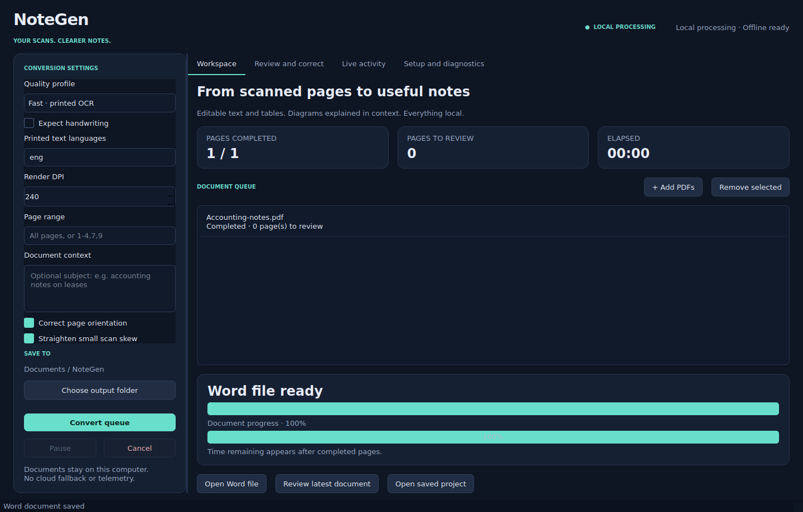
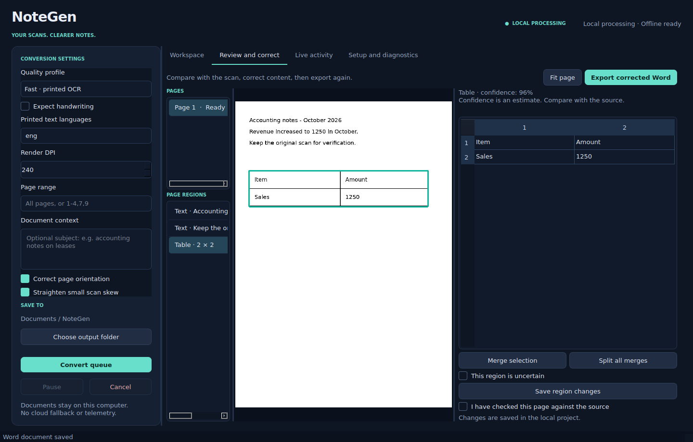

# NoteGen

**Scanned PDF → editable Word. Local AI. Native Windows desktop.**

Built for a 32 GB RAM / 16 GB NVIDIA RTX PC, including RTX 5070 Ti. Fast CPU printed
OCR handles easy content; a CUDA vision model handles difficult pages, handwriting,
table structure and grounded diagram explanations. Everything runs locally after a
one-time installation. No account, API key, document upload or cloud fallback.



## Start here

- [Download the verified Windows build](https://github.com/InduwaraLasindu/NoteGen/actions/runs/40942918948#artifacts)
  — choose **NoteGen-Windows-x64** under Artifacts. Source/model setup is described below.
- [Windows setup and usage](docs/WINDOWS.md) — portable app or source install.
- [Verification record](docs/TESTING.md) — what passed and what still needs real hardware.
- [Architecture, iterations and acceptance plan](docs/PLAN.md).
- [Primary engineering sources](docs/SOURCES.md).

From source, install Python 3.12 x64 and run:

```powershell
.\scripts\Setup-Windows.ps1 -Launch
```

Install Tesseract for printed OCR. For handwriting and contextual diagrams, install a
CUDA llama.cpp build, local vision GGUF and matching projector, then use
`scripts/Start-LocalAI.ps1`. Recommended initial model: **Qwen2.5-VL-7B-Instruct Q4_K_M**.
The setup guide includes exact commands and a diagnostics workflow. Models/runtime
executables are separate downloads, and are never fetched while converting documents.

## Features

| Feature | Behavior |
|---|---|
| Three quality profiles | Fast OCR; selective AI; AI on every page |
| Printed text and handwriting | Multilingual Tesseract + local vision; explicit uncertainty for illegible content |
| Editable tables | Ruled-table CPU recovery; AI reconstruction including borderless/merged structures; manual cell/merge correction |
| Contextual diagrams | Preserve source crop, describe visible evidence, then qualify a contextual interpretation |
| Scan preparation | Orientation check, small-angle deskew, contrast enhancement, blur warning and image size limits |
| Live activity | Stage and document progress, elapsed/estimated time, filterable logs and memory telemetry |
| Understandable errors | Stable NG codes, likely cause, suggested fix, bounded AI retry and explicit OCR fallback |
| Durable jobs | Queue, page ranges, pause/cancel and input/settings/model-bound page checkpoints |
| Human review | Side-by-side scan and editable regions; confidence flags, persistent corrections and reviewed-page markers |
| Safe exports | Editable DOCX, repeatable table headers, source figure alt text, new filenames and protected existing output |
| CLI and benchmarking | Offline diagnostics, headless conversion/re-export, exact CER/WER and sampled performance reports |



Screenshots use a generated synthetic accounting scan and real CPU OCR. They do not
claim to demonstrate AI handwriting accuracy.

## Resource design

One PDF page and one AI request run at a time. Images and page results checkpoint to
disk. PDFium runs only in the conversion worker; the GUI stays responsive through
queued Qt signals. The reference CUDA launcher limits context, image tokens, batch
size and parallel slots. App memory guards preserve completed work under pressure.

These choices target the hardware budget; actual peak VRAM and speed require the
Windows/RTX benchmark. Other running apps also consume memory. A 4-bit model's file
size is not its total GPU footprint. See the test report for measured versus untested claims.

## Limits you should know

Terrible handwriting and severely blurred text cannot always be recovered. AI can
misread text or infer a wrong diagram meaning. Review flagged content against the
source. Confidence scores are estimates, not calibrated accuracy guarantees.
Output prioritizes editable reading order and structure over a pixel-perfect facsimile.
Complex merged/borderless tables, cross-page tables and mixed scripts need corpus
evaluation; specialized handwriting models and dense-page tiling are planned quality
upgrades, not claimed tested capabilities.

## Development and build

```shell
python -m pip install -r requirements-dev-lock.txt
python -m pip install --no-deps --no-build-isolation -e .
python -m pytest -q -rA
python -m ruff check src tests scripts
```

The GitHub Actions workflow tests Linux and Windows, then builds a portable x64 ZIP
with PyInstaller and smoke-tests both executables. Successful runs attach the app in
the **NoteGen-Windows-x64** artifact. Builds are unsigned; no model is included.

The implementation is committed in tested iterations. See [CONTRIBUTING.md](CONTRIBUTING.md)
and [THIRD_PARTY_NOTICES.md](THIRD_PARTY_NOTICES.md). NoteGen code is MIT-licensed.
