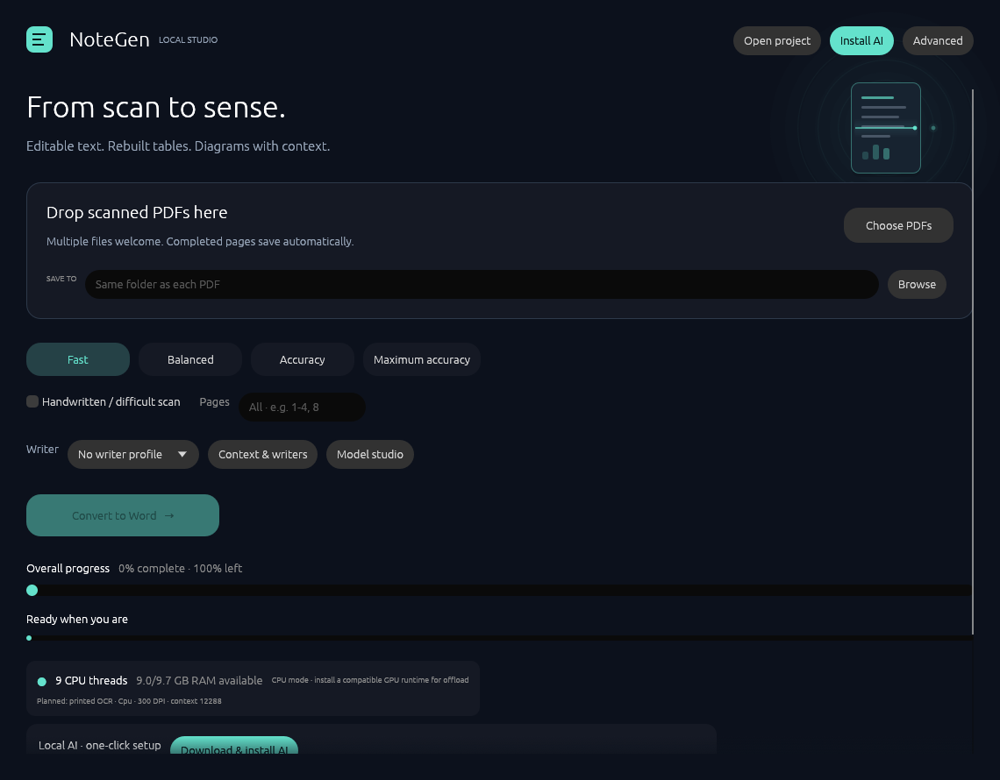

# NoteGen

**Scanned PDF → editable Word. Rust desktop. Local AI. Adaptive NVIDIA acceleration.**

NoteGen transcribes print and handwriting with local readers, rebuilds editable Word
tables, and preserves diagrams with observations and contextual interpretations.
The desktop and pipeline are Rust. PDFium, Tesseract and llama.cpp are native engines.
Python is not needed to run the current app.

[Windows installer](https://github.com/InduwaraLasindu/NoteGen/releases/latest)
· [Portable builds](https://github.com/InduwaraLasindu/NoteGen/actions/workflows/verify-and-build.yml)
· [Studio guide](docs/STUDIO.md) · [Setup](docs/WINDOWS.md) · [Verification](docs/TESTING.md) · [Iteration plan](docs/RUST_PLAN.md)

Download the installer from [GitHub Releases](https://github.com/InduwaraLasindu/NoteGen/releases/latest),
run it, and follow the wizard. It installs for your Windows account, adds Start menu
shortcuts and an optional desktop shortcut, and includes an uninstaller.

English printed OCR and Word export work immediately. For local AI, click
**Download & install AI** on the main screen or in **Studio → Readers**. The app selects
fitting readers for your preset and available RAM/VRAM, downloads the compatible runtime
and pinned model/projector pairs, verifies SHA256 and registers them. No restart is needed.
The card shows the model names and download size before starting; runtime downloads are
additional. Cancel preserves verified files and resumable partial downloads. Windows tries
compatible CUDA versions and Vulkan before a permitted CPU fallback. Advanced controls
include backend selection and a requirement for acceleration. No Python or Rust installation
is needed. The Start menu setup helper remains available for manual setup.

The **Overall progress** bar covers the whole queue, weighted by selected page counts.
Its ETA learns rendering, model startup, reading, crop retry and export costs separately.
Initial estimates are labelled, pauses and clarification waiting time are excluded, and
extra crop retries can increase the ETA. Failed/cancelled work never appears complete.

[Installer guide](docs/INSTALLER.md) · [Verification evidence](docs/TESTING.md).
Releases contain SHA256 and provenance files. The installer is unsigned.

Portable ZIPs remain available under the latest successful **Rust verification** workflow's
**NoteGen-Rust-Windows-x64** artifact. Extract both ZIP layers and keep the folder together.

Setup selects models for actual free memory, downloads pinned revisions, verifies SHA256
and registers them. Models are separate, potentially large downloads. Once installed,
conversion uses only local files and loopback HTTP. Optional public-topic lookup sends only
the query you type, after explicit opt-in. There is no cloud conversion fallback or document upload.

## Features

| Capability | Behavior |
|---|---|
| Adaptive hardware | CPU/SIMD, RAM and CUDA/Vulkan discovery; strongest fitting installed readers; memory re-admission before model load |
| Four presets | Fast printed OCR without loading/checksumming AI assets; Balanced with selective vision; Accuracy on every page; Maximum Accuracy with independent families and difficult-region crop retries |
| Print and handwriting | Tesseract baseline, LightOnOCR-3 / GLM-OCR specialists and Qwen vision; original source and all alternative readings retained |
| Ensemble decisions | Weighted medoid selects an observed transcript; duplicate models/crops do not count as independent agreement; numeric conflicts require review |
| Tables | Native ruled-grid recovery and HTML/Markdown/JSON tables; real Word cells, merges and repeated headers |
| Diagrams | Source crop, visible evidence and qualified contextual interpretation kept separately; interpretations require review |
| Scan preparation | Orientation detection, small-angle deskew, contrast normalization, blur warnings and image memory limits |
| Live activity | Page-weighted master queue bar, stage-based adaptive ETA, current document progress, byte download progress, active elapsed time, filterable JSONL/runtime logs and NG error remedies |
| One-click AI setup | In-app compatible runtime + model installation, pinned SHA256, resumable downloads, automatic registration, GPU probes and verified model reuse |
| Durable jobs | Queue, page ranges, pause, active-request cancellation, input/model/settings-bound checkpoints, restart recovery and protected output names |
| Review | Side-by-side source boxes, editable text/cells/diagram explanations, reader evidence, validated page JSON and persistent human corrections |
| Minimal native UI | Scanning-page motion graphic, orbiting accents, eased hover/preset transitions, progress sheen, completion check and animated drawers/windows; configurable in Advanced |
| Appearance controls | Light/dark, accent/background, scale, corners, speed, transition timing, orbit density, active/idle FPS, glow and reduced motion; live appearance preview while converting |
| Clarification | Source crops, exact word/number/cell corrections, contextual questions, skip/defer, and a protected local re-reading pass |
| Writer profiles | Named people, confirmed glyph/word memory, visual reference sheets, revision-aware caches, forget/delete, and profile ZIP import/export |
| Personal fonts | Real installable TTF, SVG glyphs, averaged confirmed letter samples, coverage report and preview; missing letters are reported |
| Third-party readers | Custom GGUF/projector pairs or loopback OpenAI-compatible vision services; explicit publisher update checks, SHA256-pinned activation and rollback |
| Optional public context | User-typed Wikipedia lookup, source-linked excerpts and explicit attachment; no scan/OCR/profile uploads |
| Offline CLI | Diagnostics, plans, model registration/updates, profiles/fonts, clarification, conversion, inspection and native export |

Windows UI rendering uses wgpu/Direct3D or Vulkan; AI uses CUDA/Vulkan through llama.cpp.
Actual offloaded layers are recorded in the native startup log. PDF rendering, Tesseract,
export and some preprocessing remain CPU operations. Not every operation can occupy
100% of the GPU. The UI and AI select graphics devices independently.

[Actual native motion preview](docs/images/notegen-motion.mp4). Open **Advanced → Appearance**
to customize it. Reduced motion freezes decorative graphics and transitions. Ambient
animation sleeps when unfocused; a running job still updates its status. The live log
drawer animates and virtualizes rows so long jobs do not build thousands of labels.

## Hardware and models

| VRAM | Illustrative automatic choice, when installed and enough memory is free |
|---|---|
| 4 GB | LightOnOCR-3 1B Q8 + Qwen3.5 2B Q4 |
| 8 GB | Small OCR specialist + Qwen3.5 4B Q5 |
| 16 GB | LightOnOCR-3 4B Q8 + Qwen3.5 9B Q5 |
| 32 GB | LightOnOCR-3 4B Q8 + Qwen3.8 27B Q4 |

Maximum adds a different OCR family such as GLM-OCR when it fits. One model is resident
at a time. Pages are processed per model before switching, avoiding repeated weight
loads for every page. Windows/UI memory headroom is reserved. Threads, resolution,
image tokens, context, batch and micro-batch adapt; Advanced supports manual model
selection and validated overrides. Estimates are planning inputs, not measured peaks.

Catalog checked **30 October 2026**: LightOnOCR-3, GLM-OCR, Qwen3.5 and Qwen3.8.
[Primary sources](docs/SOURCES.md) distinguish vendor models from community GGUF
conversions. Setup pins runtime b11998 and immutable model revisions/checksums.

## Quality and verification

Real PDFium/Tesseract conversion and actual GLM-OCR/LightOnOCR-3/Qwen3.5 2B CPU inference have
been exercised on a raster-only printed scan and accounting table. Tests cover model
protocols, faults/cancellation, memory profiles, consensus, persistence, Word structure
and native desktop rendering. The current source passes 65 ordinary Rust tests,
format and clippy locally. Windows/Linux CI compiles the executables and smoke-tests
the portable package. See [exact evidence and limits](docs/TESTING.md).

Terrible handwriting and severe blur can destroy information. Agreement is not a
calibrated accuracy score; AI may misread text or a diagram. Flagged content and diagram
interpretations need source review. Broad handwriting accuracy and actual peak RAM/VRAM,
speed and offload on 4/8/16/32 GB RTX PCs still require target-hardware/corpus measurement.
Word export prioritizes editable structure and reading order over a pixel-identical copy.

## Build

~~~shell
rustup toolchain install 1.99.1 --profile minimal --component rustfmt --component clippy
cargo build --locked --release --features desktop --bins
cargo run --locked --bin notegen-cli -- doctor
cargo run --locked --features desktop --bin NoteGen
~~~

Tests require Tesseract and PDFium; set NOTEGEN_PDFIUM to the native library.
[Development](CONTRIBUTING.md). The [Python predecessor](legacy/python) is archived and
is not part of the Rust release. NoteGen is MIT-licensed; dependency/model terms apply.

